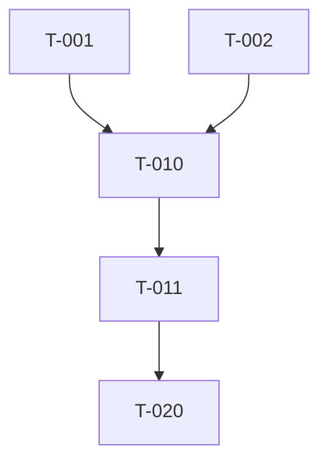

# Tasks Command (SDD)

This command decomposes a design into **executable tasks** — each one small, testable, independently verifiable, and ordered by dependency. The output is the contract that `/one-sdd:implement` consumes.

## Arguments

`$ARGUMENTS` — Feature slug.

## Pre-flight

1. **Load constitution** from `.specs/constitution.md`.
2. **Load spec** from `.specs/<slug>/spec.md`. Status MUST be `clarified`.
3. **Load design** from `.specs/<slug>/design.md`. Error if missing.

## What This Command Does

1. **Decompose the design** into tasks of 30 min – 4 hr each.
2. **Order by dependency** — earlier tasks unblock later ones. Mark tasks that can run in parallel.
3. **Group by phase** — typical phases:
   - P0: Scaffolding (migrations, types, config)
   - P1: Core domain logic (TDD)
   - P2: API / integration layer
   - P3: UI / consumer surface
   - P4: Observability, docs, rollout
4. **Acceptance criteria per task** — what test proves it's done.
5. **Trace every task** back to an FR/NFR or design section. No orphan tasks.
6. **Estimate** complexity (S/M/L) and (optionally) hours.

## Required Output Format

Write `.specs/<slug>/tasks.md`:

```markdown
# Tasks: <Feature Name>

**Slug:** <slug>
**Status:** ready
**Spec:** spec.md
**Design:** design.md
**Constitution version:** vN

## Legend
- `[ ]` = pending, `[x]` = done, `[~]` = in progress, `[!]` = blocked
- **Size:** S (<1h), M (1–3h), L (3h+ — consider splitting)
- **Parallel:** tasks marked `||` can run concurrently with the prior task

## Phase P0 — Scaffolding
- [ ] **T-001** (S) Create migration `add_notifications_table`
  - Files: `migrations/2025xxxx_add_notifications.sql`
  - Traces to: design §3
  - Acceptance: migration runs clean up and down; schema matches design
- [ ] **T-002** (S) `||` Add `Notification` type
  - Files: `lib/types/notification.ts`
  - Traces to: design §3
  - Acceptance: type compiles; exported from index

## Phase P1 — Core Domain (TDD)
- [ ] **T-010** (M) Write failing tests for `enqueueNotification`
  - Files: `lib/notifications/enqueue.test.ts`
  - Traces to: FR-1, FR-2
  - Acceptance: tests run and FAIL with clear messages
- [ ] **T-011** (M) Implement `enqueueNotification` to make T-010 pass
  - Files: `lib/notifications/enqueue.ts`
  - Traces to: FR-1, FR-2
  - Acceptance: all T-010 tests pass; coverage ≥80%

## Phase P2 — API
- [ ] **T-020** ...

## Phase P3 — UI
- [ ] **T-030** ...

## Phase P4 — Observability & Rollout
- [ ] **T-040** ...

## Dependency Graph (mermaid)


## Traceability Coverage
| Requirement | Covered by |
|-------------|------------|
| FR-1 | T-010, T-011, T-020 |
| FR-2 | T-010, T-011 |
| NFR-1 | T-040 |

## Out of Scope (Confirmed)
- (mirror spec §7)

## Summary
- Total tasks: N
- By size: S=x, M=y, L=z
- Estimated effort: H–H hours
```

## Critical Rules

- **No task larger than L (4h).** Split it.
- **Every task lists explicit files** it will touch.
- **Every task has acceptance criteria** that a test or command can verify.
- **TDD enforcement**: for any code task, the preceding task in the same phase must be the failing test (per constitution).
- **Traceability matrix must be 100%** — every FR/NFR appears under "Covered by".

## After Writing

1. Print summary: total tasks, by size, longest critical path.
2. Surface any requirements without task coverage (this should never happen — if it does, stop).
3. Recommend `/one-sdd:implement <slug>`.

## Integration

- Reads: `.specs/constitution.md`, `.specs/<slug>/spec.md`, `.specs/<slug>/design.md`
- Writes: `.specs/<slug>/tasks.md`
- Next: `/one-sdd:implement <slug>`
